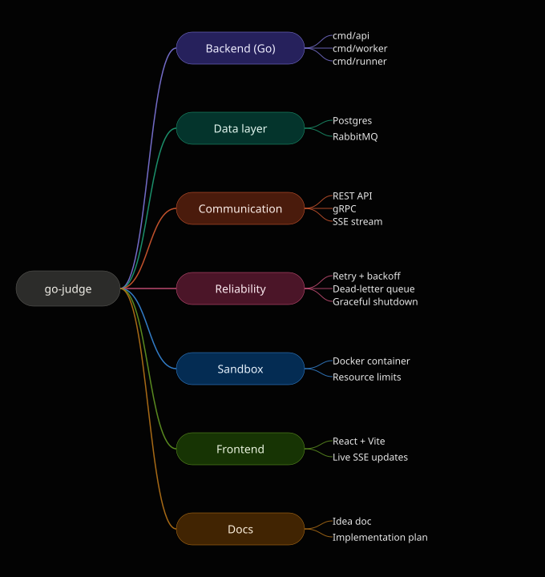

# go-judge

A local LeetCode-style judge system built with Go to practice Go syntax, REST APIs, gRPC, message queues, sandboxed code execution, and realtime updates.

You write Go code against a problem, submit it, and get back a real verdict (`PASSED` / `FAILED` / `ERROR`) from actually running `go test` — inside an isolated, resource-limited Docker container, processed asynchronously, streamed to the browser live as it happens.



## Status

All 6 planned phases are done. See the [implementation plan](docs/go-judge-implementation-plan.html) for the full phase-by-phase breakdown (goals, tasks, acceptance criteria).

| Phase | What it added |
|---|---|
| 1 — Monolith Judge (MVP) | Frontend → API → Postgres, runs `go test` synchronously in the API process |
| 2 — Code Runner (gRPC) | Code execution extracted into its own `code-runner` service |
| 3 — RabbitMQ + Judge Worker | Judging goes async — API publishes a job and returns `PENDING` immediately |
| 4 — Reliability | Retry with backoff, dead-letter queue (quorum queue, delivery limit 10), idempotent processing, graceful shutdown of API/worker/runner, a sweeper that republishes lost jobs |
| 5 — Docker Sandbox | User code runs inside a locked-down container (`--network none`, memory/cpu/pids limits, read-only root and code mount, non-root user, no capabilities, 1MB output cap) instead of directly on the runner's host |
| 6 — Realtime Result | `GET /submissions/{id}/stream` (SSE) replaces frontend polling |

## Architecture

```
Frontend (React)
   |
   | REST + SSE
   v
Backend API ---------------- Postgres
   |
   | publish
   v
RabbitMQ
   |
   | consume
   v
Judge Worker
   |
   | gRPC
   v
Code Runner  ---> docker run (sandboxed go test)
```

## Running locally

```bash
docker compose up -d                              # postgres + rabbitmq
docker build -f sandbox/gotest.Dockerfile -t gojudge-gotest:latest sandbox   # sandbox image (once, ~10s)
set -a; source .env; set +a                        # DATABASE_URL, RUNNER_ADDR, RABBITMQ_URL
migrate -path migrations -database "$DATABASE_URL" up

go run ./cmd/runner                                 # code runner (gRPC) on :50051 — shells out to `docker run`
go run ./cmd/worker                                 # judge worker (consumes RabbitMQ)
go run ./cmd/api                                    # backend on :8080

cd frontend && npm install && npm run dev            # frontend on :5173
```

Each process needs the previous one up. `.env` (gitignored) holds the local Postgres/RabbitMQ credentials and connection strings — see `docker-compose.yml` for the expected values.

The code runner needs a local Docker daemon and the `gojudge-gotest` image built above. The image ships a pre-compiled stdlib, so a submission runs in about a second; each run gets a fresh copy of that cache, so nothing persists between submissions. If the image is missing, submissions are retried and then marked `ERROR` with "sandbox unavailable".

RabbitMQ management UI: `http://localhost:15672` (`gojudge`/`gojudge`) — handy to watch jobs flow through the queue.

## Tests

```bash
go test -short ./...    # unit tests, no infrastructure needed
go test ./...           # + Docker sandbox tests (needs both sandbox images)

# integration tests against throwaway infra (migrate the DB first)
TEST_DATABASE_URL="postgres://..." TEST_RABBITMQ_URL="amqp://..." go test ./internal/submission ./internal/queue
```

## API

```
GET  /problems
GET  /problems/{id}
POST /submissions
GET  /submissions/{id}
GET  /submissions/{id}/stream   # SSE
```

## Docs

- [High-level idea](docs/go-judge-high-level-idea.md) — the original design doc: what this project is, why, and the suggested phase breakdown
- [Implementation plan](docs/go-judge-implementation-plan.html) — detailed phase-by-phase plan with goals, tasks, Go concepts, and acceptance criteria (open in a browser)

## Tech stack

- **Backend:** Go, chi, pgx/database/sql, golang-migrate
- **Communication:** gRPC (Judge Worker ↔ Code Runner), RabbitMQ (Backend API ↔ Worker), SSE (Backend API → Frontend)
- **Sandboxing:** Docker (`docker run --network none --read-only ...`)
- **Frontend:** React, Vite, TypeScript
- **Infra:** Docker Compose, PostgreSQL, RabbitMQ

## Not included (by design)

Auth, submission history, hidden tests, problem categories/difficulty filtering, admin UI, leaderboard, contest mode, multi-language support, metrics/tracing, rate limiting, plagiarism detection. This is a single-user local learning project — see the implementation plan's backlog section for the reasoning.
